# wgeasy-tg-bot

Telegram bot for managing [wg-easy](https://github.com/wg-easy/wg-easy) WireGuard devices. Create, delete, and download device configs without opening the web UI.

## Features

- Manage wg-easy devices and configuration files through Telegram.
- Give users role-based access to their devices, with configurable device limits.
- Let admins manage users and handle access and limit requests.

## Setup

### 1. Create a Telegram bot

Talk to [@BotFather](https://t.me/BotFather), create a bot, and copy the token.

### 2. Configure environment

Create a `.env` file:

```env
WG_EASY_URL=https://your-wg-easy-instance.example.com
WG_EASY_LOGIN=your-login
WG_EASY_PASSWORD=your-password
BOT_TOKEN=123456:ABC-your-bot-token
ADMIN_USERNAMES=admin1,admin2
USERNAMES=alice,bob
DEFAULT_CONFIG_LIMIT=3
USERS_DB_PATH=users.db
```

| Variable | Description |
|---|---|
| `WG_EASY_URL` | Base URL of your wg-easy instance |
| `WG_EASY_ALLOW_HTTP` | Set to `1` only for trusted internal HTTP endpoints (HTTPS is required by default) |
| `WG_EASY_LOGIN` | wg-easy username |
| `WG_EASY_PASSWORD` | wg-easy password |
| `BOT_TOKEN` | Telegram bot token from @BotFather |
| `ADMIN_USERNAMES` | Comma-separated Telegram usernames allowed to register as admins (without `@`). Existing database accounts are never promoted or rebound by this setting. Previously used admin usernames remain reserved after a username change, so a new holder of the old name cannot gain admin access. You can also promote registered users through the bot menu after they have started the bot. |
| `USERNAMES` | Comma-separated Telegram usernames of regular users bootstrap (without `@`) |
| `DEFAULT_CONFIG_LIMIT` | Default per-user device limit for newly added users (default `3`) |
| `USERS_DB_PATH` | Path to the SQLite user database (default `users.db`) |

For deployments that currently use an internal `http://` wg-easy URL, add
`WG_EASY_ALLOW_HTTP=1` to `.env` before upgrading. HTTPS deployments need no
additional setting.

### 3. Run with Docker Compose

The pre-built image is published to GitHub Container Registry on every push to `main`:

```yaml
services:
  bot:
    image: ghcr.io/illmouse/wgeasy-tg-bot:main
    # build: .   # uncomment to build locally instead of pulling the image
    env_file: .env
    restart: unless-stopped
    volumes:
      - ./users.db:/app/users.db
```

```bash
docker compose up -d
```

The bot stores users in a SQLite database. Mount a volume to persist `users.db` across container restarts (as shown above).

To test a beta release, replace `:main` in your Compose image reference with
its versioned beta tag (for example, `:v1.1.8b`), then run
`docker compose pull && docker compose up -d`. Back up `users.db` before
upgrading; restore the previous image tag and database backup to roll back.

## Usage

| Context | How to use |
|---|---|
| Private chat | `/start` — shows a persistent reply keyboard |
| Group / thread | `/menu` — sends an inline keyboard that works in threads |

### Devices

The main menu opens **Devices**. Browse the paginated list using the **All**, **Active**, **Enabled**, and **Disabled** filters. **Active** means the device's received (upload) counter increased since its previous sample; snapshots update at startup and once per minute. The list and device details show cumulative upload and download totals. Your current device usage and limit are shown in the list.

Open a device for its details and configuration download. Configuration files are delivered only to the requesting user's private chat with the bot; start the bot privately before requesting a configuration from a group. The detail card shows whether it is **Enabled** or **Disabled**, whether it is **Active** or **Inactive**, and includes the creation date with year, handshake and traffic totals. Users can rename or remove their own devices from the device details; admins can rename any device and also manage device status and removal.

Users create devices for themselves. Admins can create devices for themselves or another registered user, and may choose a custom name. Automatically generated names use an 8-character hash without a prefix. Device names can contain 1–15 letters, numbers, underscores, or hyphens. The bot delivers the configuration to the requesting user's private chat after creation.

### Commands

| Command | Description |
|---|---|
| `/start` | Show reply keyboard (private chat) |
| `/menu` | Show inline keyboard (works everywhere) |
| `/create` | Start device creation; admins can use `/create <username>` to create for a registered user |
| `/cancel` | Cancel the current operation silently and close its prompt |
| `/adduser` | Add a user — forward a message from them or send their username (admin only) |
| `/users` | Browse and manage registered users (admin only) |
| `/limit <username> <N>` | Set a user's device limit; `-1` means unlimited (admin only) |
| `/deluser <username>` | Remove a user together with all their devices (admin only) |
| `/disable <username>` | Disable a user and their devices (admin only) |
| `/enable <username>` | Enable a user and their devices (admin only) |
| `/requests` | Browse all or pending access/limit requests; approve or decline pending requests (admin only) |
| `/givemepowers` | Request access, or view your devices, limit and request history if registered |

### User management

#### Access and registration

Admins add users with `/adduser`, either by forwarding their message or sending a username, optionally followed by a device limit (for example, `alice 5`). Users are stored in SQLite. A user added by username is linked to their Telegram account when they first message the bot.

Unregistered users can request access with `/givemepowers`. Admins who have started the bot receive the request and can approve or decline it; the decision is reported to the requester. Registration confirmation includes an **Open menu** button and instructions to use `/start`.

#### User and role controls

In `/users`, admins appear first and are labeled **(admin)**. Admins can filter the registered-user list by **All**, **Enabled**, or **Disabled**, then open a user’s details to review their devices and requests, change their limit, enable or disable them, delete them, or promote/demote their role. The last admin cannot be demoted. `/disable` disables the user account and their devices; `/enable` restores access and re-enables the devices. Deleting a user also deletes their devices from wg-easy.

#### Limits and request history

Admins can set a device limit with `/limit`; `-1` means unlimited. Registered users can use **Increase device limit** to request a change, which admins can approve or decline. Admins can browse **All** or **Pending** requests with `/requests` or **Requests**. All shows a paginated request table; Pending switches to an actionable list, and limit requests show the current and requested values. User details show that user’s history, and registered users can view their own requests with `/givemepowers`.

### Screenshots

#### User experience

<table>
  <tr>
    <td align="center">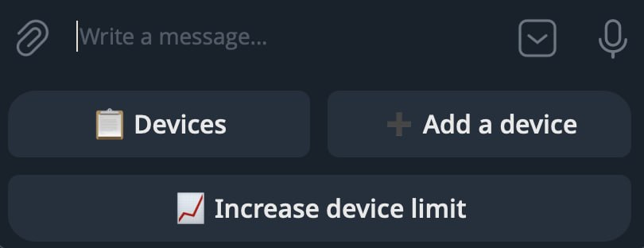<br>User menu</td>
    <td align="center">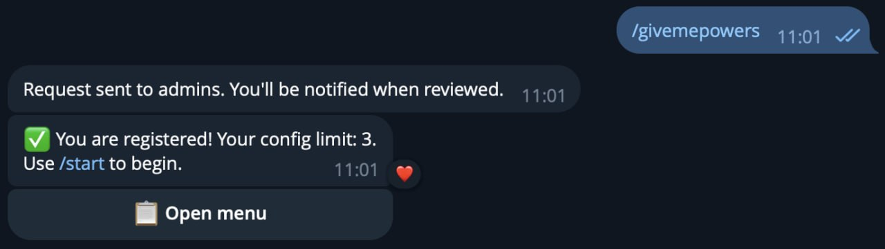<br>Access request and registration</td>
  </tr>
  <tr>
    <td align="center"><br>Request a higher device limit</td>
    <td align="center"><br>Device limit reached</td>
  </tr>
</table>

#### Admin experience

<table>
  <tr>
    <td align="center">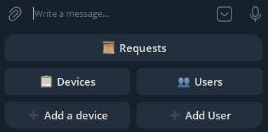<br>Admin menu</td>
    <td align="center">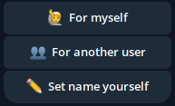<br>Create a device</td>
  </tr>
  <tr>
    <td align="center">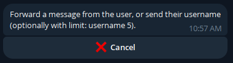<br>Add a user</td>
    <td align="center">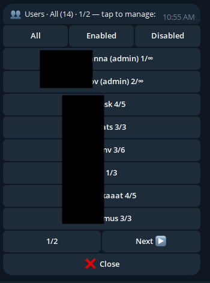<br>Registered users</td>
  </tr>
  <tr>
    <td align="center">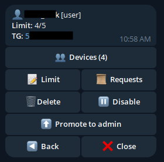<br>User details and controls</td>
    <td align="center">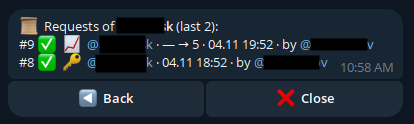<br>User request history</td>
  </tr>
  <tr>
    <td align="center">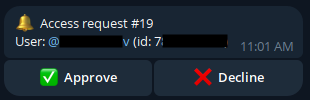<br>Review an access request</td>
    <td align="center">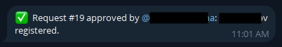<br>Approval notification</td>
  </tr>
  <tr>
    <td align="center" colspan="2">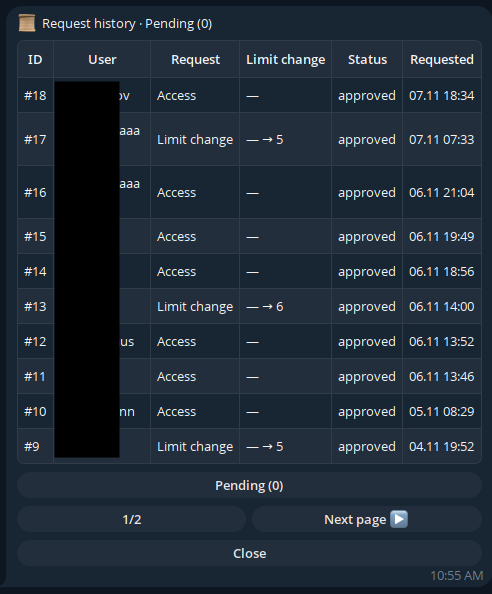<br>Paginated request history</td>
  </tr>
</table>

### Config file

When a device is created or its config is downloaded, the bot sends a `.conf` file that works with:

**AmneziaWG** (obfuscation support) — [iOS & macOS](https://apps.apple.com/us/app/amneziawg/id6478942365) · [Android](https://play.google.com/store/apps/details?id=org.amnezia.awg) · [Windows](https://github.com/amnezia-vpn/amneziawg-windows-client/releases) · [Linux](https://github.com/amnezia-vpn/amneziawg-linux-kernel-module)

**WG Tunnel** (standard WireGuard) — [Android](https://play.google.com/store/apps/details?id=com.zaneschepke.wireguardautotunnel) · [Windows](https://wgtunnel.com/download?platform=windows) · [Linux](https://wgtunnel.com/download?platform=linux)

## Requirements

- Docker & Docker Compose
- A running [wg-easy](https://github.com/wg-easy/wg-easy) instance (tested with the current API version using session-based auth)
